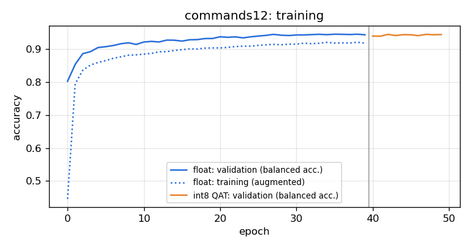
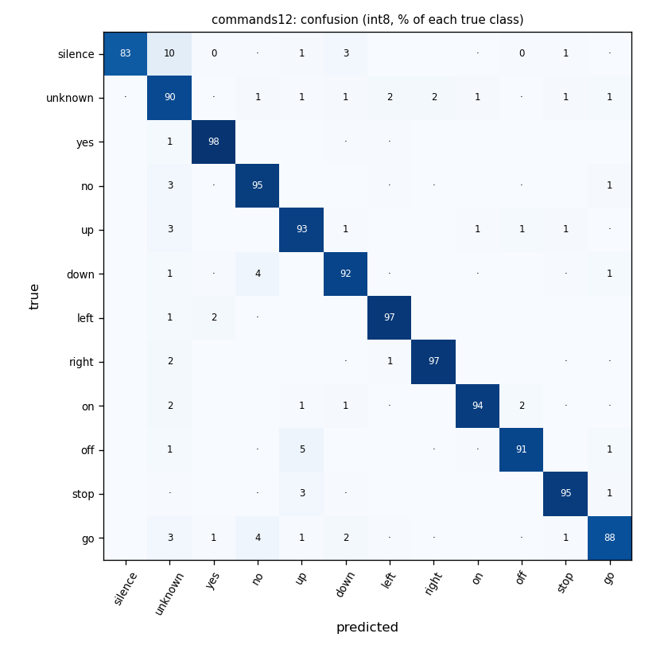
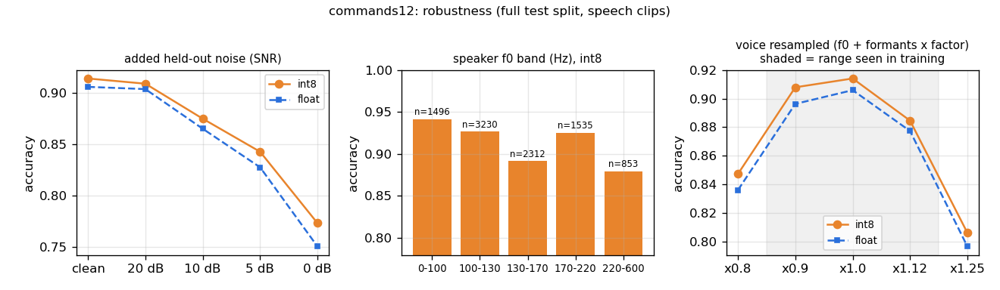
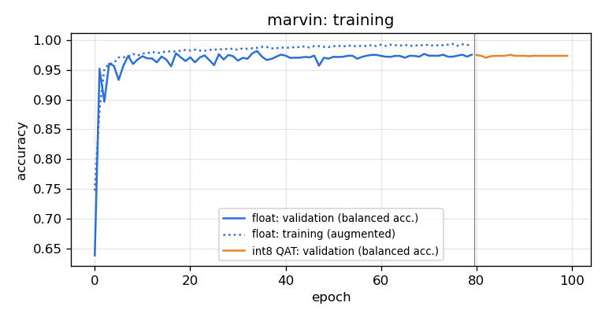
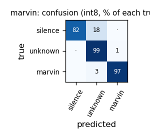
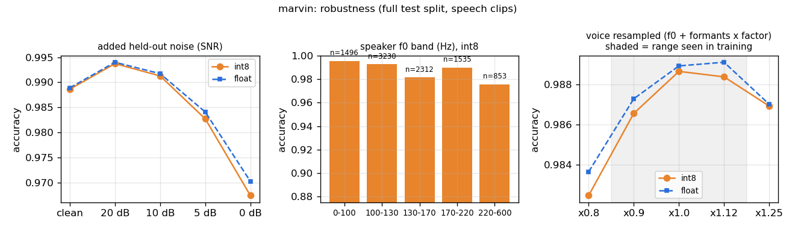
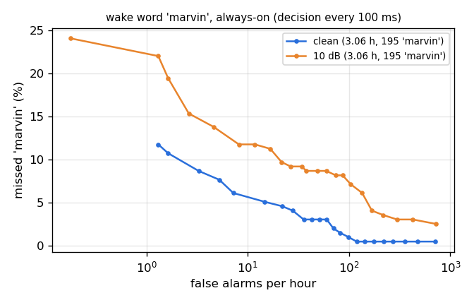

# Accuracy report: DS-CNN keyword spotter

Generated by `tools/make_report.py` from `runs/*/eval.json` (made by `evaluate.py`). Dataset: Google Speech Commands v0.02 (Warden 2018, CC-BY-4.0). Every test speaker is unseen in training (official speaker-hashed split). The noise used in tests is the held-out last 20 % of each background recording. "int8" is the deployed model: the same integers run on the MCU (C) and the NPU.

## 1. Twelve-class command model (`runs/commands12`)

### Training (commands12)

- 22348 parameters, 2.62 M multiply-accumulates per 1 s window.
- Validation = balanced accuracy (mean recall over classes; used to pick checkpoints). Best float 94.58 %; int8 straight after calibration (PTQ) 94.44 %; best QAT epoch 94.54 %. Exported: the QAT weights.



### Accuracy

| test set | clips | float | int8 (= MCU = NPU) |
|---|---|---|---|
| official v2 12-class test set | 4890 | 94.23 % | 93.84 % |
| full test split (all 35 words + 1,000 noise-only) | 12005 | 90.20 % | 90.75 % |

int8 PyTorch vs the integer reference code: identical logits on 100.00 % of the official test clips.

Per class (int8, full test split):

| class | clips | recall (found) | precision (right when it says so) |
|---|---|---|---|
| _silence_ | 1000 | 83.40 % | 99.88 % |
| _unknown_ | 6931 | 89.91 % | 97.21 % |
| yes | 419 | 97.85 % | 90.11 % |
| no | 405 | 94.81 % | 78.05 % |
| up | 425 | 93.41 % | 80.86 % |
| down | 406 | 91.87 % | 75.35 % |
| left | 412 | 96.60 % | 76.54 % |
| right | 396 | 96.72 % | 75.39 % |
| on | 396 | 94.19 % | 85.35 % |
| off | 402 | 91.29 % | 89.73 % |
| stop | 411 | 95.13 % | 81.29 % |
| go | 402 | 87.56 % | 74.73 % |



### Robustness: noise, speaker pitch, voice shift



| condition | float | int8 |
|---|---|---|
| noise clean | 90.60 % | 91.41 % |
| noise 20 dB | 90.38 % | 90.90 % |
| noise 10 dB | 86.51 % | 87.49 % |
| noise 5 dB | 82.74 % | 84.26 % |
| noise 0 dB | 75.01 % | 77.29 % |
| speaker f0 0-100 Hz (1496 clips) | 93.92 % | 94.12 % |
| speaker f0 100-130 Hz (3230 clips) | 92.04 % | 92.66 % |
| speaker f0 130-170 Hz (2312 clips) | 88.32 % | 89.14 % |
| speaker f0 170-220 Hz (1535 clips) | 91.40 % | 92.51 % |
| speaker f0 220-600 Hz (853 clips) | 86.17 % | 87.92 % |
| speaker f0 not found (1579 clips) | 89.42 % | 90.44 % |
| voice resampled x0.8 | 83.59 % | 84.72 % |
| voice resampled x0.9 | 89.63 % | 90.80 % |
| voice resampled x1.0 | 90.60 % | 91.41 % |
| voice resampled x1.12 | 87.73 % | 88.46 % |
| voice resampled x1.25 | 79.64 % | 80.59 % |

Test-speaker f0 (YIN): 5th / 25th / 50th / 75th / 95th percentile = 87 / 107 / 129 / 170 / 242 Hz.

How to read these rows:
- *f0 bands* are real speakers, but each band also has its own mix of speakers, microphones and words, so a few % between bands is not caused by pitch alone. The *resampled* rows are the controlled experiment: the same clips, only the voice changed. x0.85..x1.15 was used in training augmentation; x0.8 and x1.25 are outside it.
- *full test split* and the noise/pitch rows count every clip, and 58 % of them are `_unknown_` words. A model (or a condition, like light noise) that pushes the decision towards 'unknown' scores higher there: that is why int8 can beat float, or 20 dB noise beat clean, on these rows. Use the per-class recall, the balanced official test set and (for the wake word) the streaming test to judge.

Published references (12-class Speech Commands; test subsets differ, so +-1 % is noise): MLPerf Tiny KWS (DS-CNN, 49x10 MFCC input like ours): quality target 90 % top-1, reference model 92.2 % on its 1,000-clip test subset (arXiv:2106.07597). Hello Edge (arXiv:1711.07128, Speech Commands v1): the largest DS-CNN 95.4 %; the small DS-CNN (our size class) ~94.4 % (from the paper's table, as I recall it; check the PDF before quoting).

## 2. Wake word "marvin" (`runs/marvin`)

### Training (marvin)

- 21763 parameters, 2.62 M multiply-accumulates per 1 s window.
- Validation = balanced accuracy (mean recall over classes; used to pick checkpoints). Best float 98.15 %; int8 straight after calibration (PTQ) 97.79 %; best QAT epoch 97.51 %. QAT never beat PTQ here, so the exported int8 model is the PTQ one (calibrated float weights).



### Accuracy

| test set | clips | float | int8 (= MCU = NPU) |
|---|---|---|---|
| full test split (all 35 words + 1,000 noise-only) | 12005 | 97.45 % | 97.44 % |

Per class (int8, full test split):

| class | clips | recall (found) | precision (right when it says so) |
|---|---|---|---|
| _silence_ | 1000 | 81.80 % | 99.88 % |
| _unknown_ | 10810 | 98.90 % | 98.29 % |
| marvin | 195 | 96.92 % | 61.17 % |



### Robustness: noise, speaker pitch, voice shift



| condition | float | int8 |
|---|---|---|
| noise clean | 98.89 % | 98.86 % |
| noise 20 dB | 99.40 % | 99.37 % |
| noise 10 dB | 99.17 % | 99.13 % |
| noise 5 dB | 98.41 % | 98.27 % |
| noise 0 dB | 97.03 % | 96.75 % |
| speaker f0 0-100 Hz (1496 clips) | 99.53 % | 99.53 % |
| speaker f0 100-130 Hz (3230 clips) | 99.29 % | 99.26 % |
| speaker f0 130-170 Hz (2312 clips) | 98.10 % | 98.14 % |
| speaker f0 170-220 Hz (1535 clips) | 99.02 % | 98.96 % |
| speaker f0 220-600 Hz (853 clips) | 97.66 % | 97.54 % |
| speaker f0 not found (1579 clips) | 99.18 % | 99.11 % |
| voice resampled x0.8 | 98.36 % | 98.25 % |
| voice resampled x0.9 | 98.73 % | 98.66 % |
| voice resampled x1.0 | 98.89 % | 98.86 % |
| voice resampled x1.12 | 98.91 % | 98.84 % |
| voice resampled x1.25 | 98.70 % | 98.69 % |

Test-speaker f0 (YIN): 5th / 25th / 50th / 75th / 95th percentile = 87 / 107 / 129 / 170 / 242 Hz.

How to read these rows:
- *f0 bands* are real speakers, but each band also has its own mix of speakers, microphones and words, so a few % between bands is not caused by pitch alone. The *resampled* rows are the controlled experiment: the same clips, only the voice changed. x0.85..x1.15 was used in training augmentation; x0.8 and x1.25 are outside it.
- *full test split* and the noise/pitch rows count every clip, and 90 % of them are `_unknown_` words. A model (or a condition, like light noise) that pushes the decision towards 'unknown' scores higher there: that is why int8 can beat float, or 20 dB noise beat clean, on these rows. Use the per-class recall, the balanced official test set and (for the wake word) the streaming test to judge.

### Always-on test (what matters for a wake word)

All 11,005 test clips are joined into one recording (3 h; 'marvin' appears ~200 times among 34 other words). The detector runs every 100 ms on the last 1 s, averages P(marvin) over 3 decisions, triggers above a threshold and then sleeps 1 s. A trigger within 2 s of a 'marvin' start is a hit, anything else a false alarm.



**clean**

| threshold | missed | false alarms | per hour |
|---|---|---|---|
| 0.5 | 1.54 % | 249 | 81.45 |
| 0.8 | 4.10 % | 85 | 27.81 |
| 0.9 | 5.13 % | 45 | 14.72 |
| 0.95 | 6.15 % | 22 | 7.20 |
| 0.98 | 8.72 % | 10 | 3.27 |
| 0.99 | 10.77 % | 5 | 1.64 |

False alarms at threshold 0.95, by the word being said: wow 3, backward 2, five 2, nine 2, bird 2, stop 1, eight 1, on 1, cat 1, four 1, forward 1, dog 1, right 1, up 1, no 1, three 1.

**10 dB**

| threshold | missed | false alarms | per hour |
|---|---|---|---|
| 0.5 | 8.72 % | 182 | 59.54 |
| 0.8 | 11.28 % | 51 | 16.68 |
| 0.9 | 11.79 % | 25 | 8.18 |
| 0.95 | 13.85 % | 14 | 4.58 |
| 0.98 | 19.49 % | 5 | 1.64 |
| 0.99 | 22.05 % | 4 | 1.31 |

False alarms at threshold 0.95, by the word being said: right 3, backward 3, bird 1, five 1, wow 1, cat 1, forward 1, four 1, nine 1, one 1.

The false alarms are look-alike sounds: words sharing the r-coloured vowel (/ar/ of mARvin ~ bIRd, backWARD, forWARD), the /v/ (fiVe) or the final /n/ (niNE). The standard fixes are hard-negative training (more such words), a longer or stricter smoothing rule, and a second-stage verifier.

Caveat: the negatives are isolated words, 34 of them, said on purpose. Real use has hours of conversation, TV and music, which give more look-alike sounds; products measure false alarms on hundreds of hours of such audio and add a second-stage check.

## 3. Deployment checks

Note on model selection: the first training runs (kept in `runs/archive_selection_by_plain_acc/`) chose checkpoints by plain accuracy on a validation set that is ~60 % `_unknown_` clips. That metric rewards a bias towards 'unknown': int8 looked 1.5 % better than float there, but on the balanced official test set it was float 94.38 % / int8 93.84 %. All runs reported above choose checkpoints by balanced accuracy instead.

**NPU (commands12)**: AMD Phoenix (Ryzen 7 PRO 7840U), Ryzen AI 1.8 Linux, 1x4 overlay. 4890 official-test inputs: 100.000 % of logits identical to the integer reference (max diff 0 LSB); accuracy of the NPU outputs 93.84 %. RESULT npu: run OK, 0.72 ms per frame (4890 frames, max 13.084607 ms). Compile: compile: OK; graph after compile (EPContext = NPU part, the rest runs on CPU): {'QuantizeLinear': 1, 'com.microsoft::EPContext': 1, 'DequantizeLinear': 1}; output: runs/commands12/npu/dscnn_int8.phx18_ctx.onnx

**MCU C code (commands12)**: network 100.000 % identical logits on 4890 inputs. Full C pipeline (C MFCC + C network) on 4890 raw clips: 99.999 % of int8 features identical to Python (max 1 LSB; float FFT order differs), logits identical for 99.61 % of clips, same predicted class for 100.00 %. Laptop timing: RESULT 4890 inputs; host time per inference: network 1450.3 us, front end 616.5 us per 1 s clip (49 frames)

```
build/cm4/dscnn_int8.o  :
.text                            0      0
.text.dscnn_run                892      0
.ARM.exidx.text.dscnn_run        8      0
Total                         1013
build/cm4/kws_frontend.o  :
.text                                    0      0
.text.kws_frontend_init                280      0
.ARM.exidx.text.kws_frontend_init        8      0
.text.kws_mfcc_frame                   776      0
.ARM.exidx.text.kws_mfcc_frame           8      0
.text.kws_mfcc_clip                     30      0
.ARM.exidx.text.kws_mfcc_clip            8      0
.text.kws_stream_init                   10      0
.ARM.exidx.text.kws_stream_init          8      0
.text.kws_stream_push                   80      0
.ARM.exidx.text.kws_stream_push          8      0
.bss.tw_re                            2048      0
.bss.tw_im                            2048      0
.bss.bitrev                           2048      0
.bss.kws_mfcc_frame.re                4096      0
.bss.kws_mfcc_frame.im                4096      0
Total                                15665
build/cm4/kws_frontend_tables.o  :
.text                        0      0
.rodata.kws_hann          2560      0
.rodata.kws_mel_start       80      0
.rodata.kws_mel_len         80      0
.rodata.kws_mel_off         80      0
.rodata.kws_mel_w         1972      0
.rodata.kws_dct           1600      0
.rodata.kws_mean            40      0
.rodata.kws_std             40      0
Total                     6563
build/cm4/kws_model_data.o  :
.text                          0      0
.rodata.str1.1               154      0
.rodata.KWS_CLASS_NAMES       48      0
.rodata.stem_w              2304      0
.rodata.stem_b                64      0
.rodata.blocks_0_w           576      0
.rodata.blocks_0_b            64      0
.rodata.blocks_1_w          4096      0
.rodata.blocks_1_b            64      0
.rodata.blocks_2_w           576      0
.rodata.blocks_2_b            64      0
.rodata.blocks_3_w          4096      0
.rodata.blocks_3_b            64      0
.rodata.blocks_4_w           576      0
.rodata.blocks_4_b            64      0
.rodata.blocks_5_w          4096      0
.rodata.blocks_5_b            64      0
.rodata.blocks_6_w           576      0
.rodata.blocks_6_b            64      0
.rodata.blocks_7_w          4096      0
.rodata.blocks_7_b            64      0
.rodata.classifier_w         768      0
.rodata.classifier_b          12      0
.rodata.KWS_LAYERS           836      0
Total                      23517
```

**NPU (marvin)**: AMD Phoenix (Ryzen 7 PRO 7840U), Ryzen AI 1.8 Linux, 1x4 overlay. 4890 official-test inputs: 100.000 % of logits identical to the integer reference (max diff 0 LSB). RESULT npu: run OK, 0.63 ms per frame (4890 frames, max 1.194363 ms). Compile: compile: OK; graph after compile (EPContext = NPU part, the rest runs on CPU): {'QuantizeLinear': 1, 'com.microsoft::EPContext': 1, 'DequantizeLinear': 1}; output: runs/marvin/npu/dscnn_int8.phx18_ctx.onnx

**MCU C code (marvin)**: network 100.000 % identical logits on 4890 inputs. Full C pipeline (C MFCC + C network) on 4890 raw clips: 100.000 % of int8 features identical to Python (max 1 LSB; float FFT order differs), logits identical for 99.98 % of clips, same predicted class for 100.00 %. Laptop timing: RESULT 4890 inputs; host time per inference: network 1611.2 us, front end 546.8 us per 1 s clip (49 frames)

```
build/cm4/dscnn_int8.o  :
.text                            0      0
.text.dscnn_run                892      0
.ARM.exidx.text.dscnn_run        8      0
Total                         1013
build/cm4/kws_frontend.o  :
.text                                    0      0
.text.kws_frontend_init                280      0
.ARM.exidx.text.kws_frontend_init        8      0
.text.kws_mfcc_frame                   776      0
.ARM.exidx.text.kws_mfcc_frame           8      0
.text.kws_mfcc_clip                     30      0
.ARM.exidx.text.kws_mfcc_clip            8      0
.text.kws_stream_init                   10      0
.ARM.exidx.text.kws_stream_init          8      0
.text.kws_stream_push                   80      0
.ARM.exidx.text.kws_stream_push          8      0
.bss.tw_re                            2048      0
.bss.tw_im                            2048      0
.bss.bitrev                           2048      0
.bss.kws_mfcc_frame.re                4096      0
.bss.kws_mfcc_frame.im                4096      0
Total                                15665
build/cm4/kws_frontend_tables.o  :
.text                        0      0
.rodata.kws_hann          2560      0
.rodata.kws_mel_start       80      0
.rodata.kws_mel_len         80      0
.rodata.kws_mel_off         80      0
.rodata.kws_mel_w         1972      0
.rodata.kws_dct           1600      0
.rodata.kws_mean            40      0
.rodata.kws_std             40      0
Total                     6563
build/cm4/kws_model_data.o  :
.text                             0      0
.rodata.str1.1                  184      0
.rodata.KWS_CLASS_NAMES          12      0
.rodata.stem_w                 2304      0
.rodata.stem_b                   64      0
.rodata.block0_depthwise_w      576      0
.rodata.block0_depthwise_b       64      0
.rodata.block0_pointwise_w     4096      0
.rodata.block0_pointwise_b       64      0
.rodata.block1_depthwise_w      576      0
.rodata.block1_depthwise_b       64      0
.rodata.block1_pointwise_w     4096      0
.rodata.block1_pointwise_b       64      0
.rodata.block2_depthwise_w      576      0
.rodata.block2_depthwise_b       64      0
.rodata.block2_pointwise_w     4096      0
.rodata.block2_pointwise_b       64      0
.rodata.block3_depthwise_w      576      0
.rodata.block3_depthwise_b       64      0
.rodata.block3_pointwise_w     4096      0
.rodata.block3_pointwise_b       64      0
.rodata.classifier_w            192      0
.rodata.classifier_b              3      0
.rodata.KWS_LAYERS              836      0
Total                         22926
```
